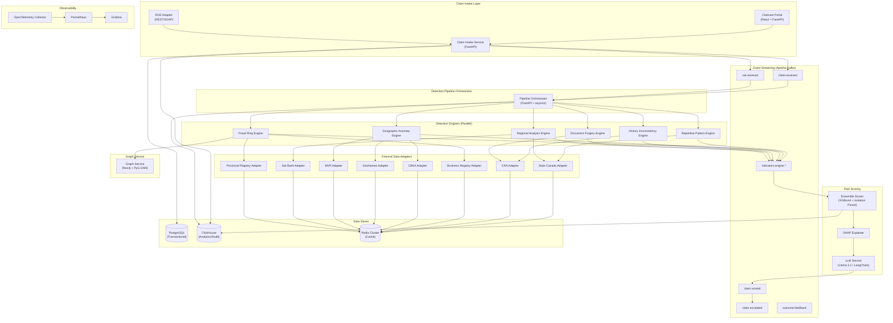
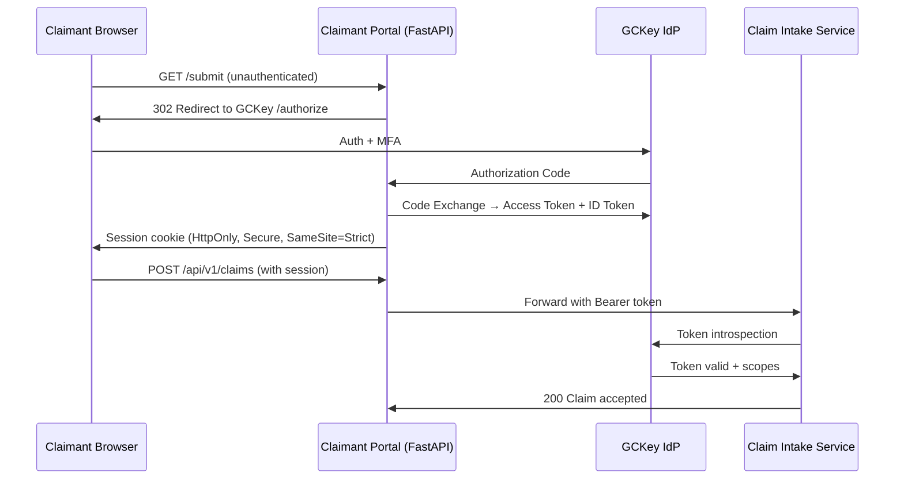

# Design Document: AI-Enabled Employment Insurance Anomaly Detection Solution (EI-ADS)

## Overview

EI-ADS is a real-time fraud detection platform that processes every EI claim submission through six parallel AI detection engines, cross-references eight external data sources, and produces an explainable risk score and routing decision within two seconds of claim receipt.

The system is built on an event-driven microservices architecture where claim events flow through Apache Kafka, each detection engine runs as an independent service, and an Ensemble Scorer aggregates the results. All components run on Kubernetes/OpenShift on a Government Cloud platform (GCP or Azure Government), classified at Protected B, and comply with the Privacy Act and PIPEDA.

**Primary design goals:**
- End-to-end latency of ≤ 2,000 ms per claim at 500 concurrent claims
- Six detection engines executing in parallel (never sequentially)
- Explainable bilingual (EN/FR) risk decisions using SHAP and Llama 3.1
- 85%+ fraud detection rate with < 5% false positive rate
- 7-year immutable audit trail for all claim data and decisions

---

## Architecture

### System Component Diagram



### Time Budget Allocation

| Component | Time Budget | Cumulative |
|---|---|---|
| Claim Intake + Kafka publish | 500 ms | 500 ms |
| Pipeline initiation after both events | 100 ms | 600 ms |
| Repetitive Pattern Engine | 400 ms | — |
| Geographic Anomaly Engine | 600 ms | — |
| Fraud Ring Engine | 800 ms | — |
| History Inconsistency Engine | 500 ms | — |
| Document Forgery Engine | 700 ms | — |
| Regional Analysis Engine | 500 ms | — |
| Ensemble Scorer (post-engines) | 300 ms | — |
| **Total (engines run in parallel)** | **≤ 2,000 ms** | **2,000 ms** |

The engines run concurrently; the wall-clock budget for the engine phase is bounded by the slowest completing engine (800 ms for Fraud Ring Engine), not the sum.

---

## Components and Interfaces

### Claim Intake Service

**Responsibilities:** Authenticates claimants via GCKey OAuth 2.0, validates claim fields, assigns Claim_IDs, persists to PostgreSQL, publishes to Kafka.

**Input:** `POST /api/v1/claims` — multipart form (claim fields + optional ROE document upload)

**Output Events:**
```json
// claim.received
{
  "claim_id": "uuid",
  "sin_hash": "sha256",
  "employer_bn": "123456789RT0001",
  "received_at": "ISO-8601",
  "status": "RECEIVED"
}
```

**Validation rules:** Mandatory field presence check, SIN Luhn checksum, BN format (9 digits + RT + 4 digits), insurable hours > 0, earnings > 0, separation date ≤ today.

**Error response format:**
```json
{
  "errors": [
    {"field": "insurable_hours", "code": "MISSING", "hint": "Enter the total insurable hours worked."}
  ]
}
```

### ROE Adapter

**Responsibilities:** Accepts ROE documents via REST (JSON/XML) or SOAP from ROE Web, normalises to canonical Claim model, publishes `roe.received` event.

**Supported protocols:** REST (JSON, XML), SOAP 1.1/1.2 with WSDL from ROE Web

**Normalisation:** Maps ROE field names to canonical model; detects encoding (UTF-8, ISO-8859-1) and converts.

### Detection Pipeline Orchestrator

**Responsibilities:** Subscribes to both `claim.received` and `roe.received`, waits for the pair (with configurable correlation timeout of 60 s), launches all six engines concurrently using asyncio task groups, monitors per-engine time budgets, handles PARTIAL_RESULT on timeout, enforces the ≥ 3-engines minimum, publishes INDETERMINATE decision if minimum not met.

**Concurrency model:** Each engine invocation is an async HTTP call to the engine's FastAPI service, wrapped in `asyncio.wait_for` with the per-engine timeout.

### LLM Service

**Responsibilities:** Wraps Llama 3.1 (70B) via LangChain with a RAG pipeline backed by a Chroma vector store of historical claim explanations. Provides two operations: narrative similarity scoring (cosine similarity via sentence embeddings) and explanation generation (structured chain-of-thought prompt → EN/FR bilingual output).

**API:**
```
POST /llm/similarity   — returns cosine_similarity float [0,1]
POST /llm/explain      — returns {en: str, fr: str, word_count_en: int, word_count_fr: int}
```

### Graph Service

**Responsibilities:** Maintains the bipartite claimant-employer graph in Neo4j. Exposes graph construction (upsert edges on claim receipt), community detection (via GNN on PyTorch Geometric), and link analysis queries.

**Graph schema:** `(:Claimant {sin_hash})-[:EMPLOYED_BY {separation_date, roe_ts}]->(:Employer {bn})`

**Community detection:** Louvain algorithm on the projected claimant-only graph (shared employer = edge), augmented by a GraphSAGE GNN trained on historical fraud ring patterns.

---

## Data Models

### Canonical Claim Model

```python
@dataclass
class Claim:
    claim_id: UUID
    sin_hash: str                    # SHA-256 of SIN; raw SIN never stored outside encrypted PG
    employer_bn: str                 # 15-char BN (9-digit + RT + 4-digit)
    insurable_hours: Decimal         # Decimal(10, 2)
    insurable_earnings: Decimal      # Decimal(12, 2)
    separation_date: date
    separation_reason: str           # Free text, max 1000 chars
    separation_reason_code: str      # ROE reason code (A–N)
    claim_start_date: date
    economic_region_code: str        # ESDC 2-char region code
    noc_code: str                    # NOC 2021 5-digit code
    residential_postal_code: str     # First 3 chars (FSA) only
    residential_address_hash: str    # SHA-256 of full address
    employer_work_location: str      # Full address
    received_at: datetime
    status: ClaimStatus              # RECEIVED | PROCESSING | SCORED | ERROR
    roe_document_id: Optional[UUID]
    protected_b: bool = True
```

### Indicator Model

```python
@dataclass
class Indicator:
    indicator_id: UUID
    claim_id: UUID
    engine: EngineType               # REPETITIVE_PATTERN | GEOGRAPHIC | FRAUD_RING | 
                                     # HISTORY_INCONSISTENCY | DOCUMENT_FORGERY | REGIONAL
    severity: Severity               # LOW | MEDIUM | HIGH | CRITICAL | UNRESOLVED
    algorithm: str                   # E.g. "sequential_pattern_mining", "haversine_distance"
    title: str                       # Short description (≤ 100 chars)
    explanation_en: str              # Natural language, ≤ 500 chars
    explanation_fr: str              # French equivalent
    payload: dict                    # Structured evidence (amounts, dates, identifiers)
    produced_at: datetime
    shap_contribution: Optional[float] = None
```

### Risk Score / Risk Decision Model

```python
@dataclass
class RiskAssessment:
    assessment_id: UUID
    claim_id: UUID
    risk_score: int                  # [0, 100]
    risk_decision: RiskDecision      # AUTO_APPROVE | FLAG_FOR_REVIEW | INVESTIGATE | INDETERMINATE
    shap_base_value: float
    shap_attributions: list[ShapAttribution]   # one per Indicator
    explanation_en: str              # LLM-generated, ≤ 500 chars
    explanation_fr: str
    engines_completed: list[EngineType]
    engines_partial: list[EngineType]
    scored_at: datetime
    model_version: str

@dataclass
class ShapAttribution:
    indicator_id: UUID
    feature_name: str
    contribution: float              # Signed; sum == risk_score - base_value
```

### LabourForceData Model

```python
@dataclass
class LabourForceData:
    reference_month: date            # First day of the reference month
    esdc_region_code: str            # ESDC 2-char economic region code
    region_name_en: str
    region_name_fr: str
    unemployment_rate: Decimal       # Decimal(8, 4) — 4 decimal places minimum
    employment_rate: Decimal         # Decimal(8, 4)
    participation_rate: Decimal      # Decimal(8, 4)
    national_unemployment_rate: Decimal  # Decimal(8, 4) — national average for same month
    source_api_version: str
    retrieved_at: datetime
    data_stale: bool = False
```

### Graph Node/Edge Models (Neo4j)

```cypher
-- Node labels
(:Claimant {
  sin_hash: String,           -- SHA-256 of SIN
  postal_fsa: String,         -- First 3 chars of postal code
  surname_hash: String,       -- SHA-256 of normalized surname
  province_code: String,
  created_at: DateTime
})

(:Employer {
  bn: String,                 -- 15-char BN
  name: String,
  registered_address_hash: String,
  registration_date: Date,
  address_type: String,       -- "residential" | "commercial" | "unknown"
  created_at: DateTime
})

-- Relationship
(:Claimant)-[:EMPLOYED_BY {
  separation_date: Date,
  roe_submission_ts: DateTime,
  insurable_hours: Float,
  claim_id: String
}]->(:Employer)

-- Community membership (written by Graph Service post-detection)
(:Claimant)-[:IN_COMMUNITY {
  community_id: String,
  detection_run_id: String
}]->(:Employer)
```

---

## Detection Engine Designs

### 1. Repetitive Pattern Engine

**Responsibilities:** Detects systematic benefit gaming through sequential claim patterns, hours-clustering near thresholds, and LLM-detected verbatim narratives.

**Algorithm Pipeline:**

```
1. Retrieve 60-month claim history for SIN from PostgreSQL
2. Filter to same employer BN → check for ≥ 3 claims in any 36-month window
3. Sequential pattern mining (PrefixSpan on claim date sequences)
   - Pattern: inter-claim intervals within ±14 days of each other
4. Hours clustering analysis
   - Retrieve regional minimum qualifying threshold from ESDC config
   - Flag if |insurable_hours - threshold| ≤ 5 AND same pattern in ≥ 2 prior claims
5. LLM narrative similarity (async, timeout 5 s)
   - Embed all reason-for-separation narratives via sentence-transformers
   - Compute pairwise cosine similarity
   - Flag pairs with similarity > 0.92
6. Publish all Indicators to Kafka within 400 ms (excluding LLM wait)
```

**Key algorithms:**
- **PrefixSpan** for sequential pattern mining over claim date sequences
- **Sentence-BERT** (all-MiniLM-L6-v2) for narrative embedding and cosine similarity
- **LangChain** chain to route similarity scores to Llama 3.1 for narrative classification

**Indicator generation rules:**
| Condition | Severity |
|---|---|
| ≥ 3 claims from same employer in 36 months | HIGH |
| Hours within 5 of min threshold, same pattern in ≥ 2 prior claims | HIGH |
| Cosine similarity > 0.92 across narratives | MEDIUM |
| LLM service timeout (5 s) | NARRATIVE_ANALYSIS_TIMEOUT flag |
| Claim history DB unavailable | DATA_UNAVAILABLE |

### 2. Geographic Anomaly Engine

**Responsibilities:** Detects ghost employment via geospatial implausibility, absence of transportation means, economic cost analysis, and CBSA cross-border absence detection.

**Algorithm Pipeline:**

```
1. Resolve residential postal code → (lat, lon) via GeoNames Adapter
2. Resolve employer work location → (lat, lon) via GeoNames Adapter
3. Compute Haversine geodesic distance (precision: 4 decimal places)
4. If distance > 100 km:
   a. Query MVR Adapter — no vehicle → HIGH Indicator
   b. Query GeoNames transit routes — no route → HIGH Indicator
   c. Compute weekly transport cost (lowest-cost mode):
      - Flight: round-trip cheapest fare from CBSA-correlated fare DB
      - Bus: BC Transit / Greyhound fare estimate
      Compare to claimant's weekly EI benefit rate
      If cost > benefit → CRITICAL Indicator with CAD amounts (2 dp) and ratio
5. Retrieve prior 2 employer locations; if both > 100 km from residence:
   → Add employer names, distances, dates to Indicator
6. Query CBSA Adapter for cross-border absence during employment period
   → If ≥ 10 consecutive days outside Canada → HIGH Indicator
7. Publish all Indicators within 600 ms
```

**Haversine formula:**
```python
def haversine(lat1, lon1, lat2, lon2) -> float:
    R = 6371.0  # Earth radius in km
    φ1, φ2 = radians(lat1), radians(lat2)
    Δφ = radians(lat2 - lat1)
    Δλ = radians(lon2 - lon1)
    a = sin(Δφ/2)**2 + cos(φ1) * cos(φ2) * sin(Δλ/2)**2
    return round(R * 2 * atan2(sqrt(a), sqrt(1-a)), 4)
```

**Symmetry guarantee:** The formula is algebraically symmetric; distance(A, B) == distance(B, A) by construction.

### 3. Fraud Ring Engine

**Responsibilities:** Detects shell employers, coordinated mass layoffs, and claimant community clusters using graph analytics.

**Algorithm Pipeline:**

```
1. Graph construction (via Graph Service):
   - Upsert Claimant and Employer nodes for current claim
   - Add EMPLOYED_BY edge with separation_date and roe_submission_ts
   - Retrieve all edges for employer BN within prior 24 months

2. Shell employer detection (Business Registry Adapter):
   - If employer registered within 12 months of separation_date
     AND address_type == "residential" → CRITICAL Indicator
   - If no registry record found → HIGH Indicator

3. Coordinated layoff detection:
   - Load all employees separated in the 90-day window before separation_date
   - If ≥ 80% share the same separation calendar date
     AND all ROEs submitted within any 24-hour rolling window → CRITICAL Indicator

4. Community detection (Graph Service / GNN):
   - Run Louvain + GraphSAGE on 24-month employer cohort
   - If ≥ 40% of cohort share postal FSA (first 3 chars) OR surname_hash → CRITICAL Indicator

5. Hours-band analysis:
   - If cohort ≥ 3 claimants AND all insurable hours within 10-hour band
     at or above minimum qualifying threshold → HIGH Indicator
   - If cohort < 3 → NOT_EVALUATED disposition

6. Publish all Indicators within 800 ms
```

**GNN architecture:** GraphSAGE (2-layer, hidden dim 64) trained on historical fraud ring labels. Node features: normalized insurable hours, separation_date ordinal, postal FSA embedding. Edge features: days since separation, roe_submission_ts offset.

**Shell employer heuristics:**
1. Registered address is residential (GeoNames zoning + postal FSA residential range)
2. Registration date within 12 months of mass separation
3. No public commercial web presence (domain check, optional)
4. 100% employee turnover within 6 months of registration

### 4. Employment History Inconsistency Engine

**Responsibilities:** Cross-references ROE declarations against CRA T4 data, validates NOC codes, detects concurrent employment, and uses LLM to identify narrative contradictions.

**Algorithm Pipeline:**

```
1. Retrieve CRA T4 record (CRA Adapter, 5 s timeout)
   - Match by employer BN and tax year of separation_date

2. Earnings discrepancy check:
   - If |ROE_earnings - T4_earnings| > $2,000 → CRITICAL Indicator
   - If ROE_earnings == T4_earnings → discrepancy = 0, no Indicator (P4 invariant)
   - If fields missing or non-numeric → UNRESOLVED Indicator

3. NOC code validation (CRA employer industry category):
   - Map CRA employer industry category to NOC major group
   - If declared NOC major group != CRA industry NOC major group → HIGH Indicator

4. LLM contradiction detection (async, timeout 10 s):
   - If CRA shows continued employment during claimed separation period:
     → Pass to LLM: "Does this narrative contradict continued employment? (YES/NO + evidence)"
     → If LLM returns YES → CRITICAL Indicator

5. Concurrent employment detection:
   - Query CRA for all BNs active for the SIN during claim period
   - If any second employer BN active during any portion of claim period → CRITICAL Indicator

6. Publish all Indicators within 500 ms (excluding LLM wait)
```

**Discrepancy calculation:**
```python
def compute_discrepancy(roe_earnings: Decimal, t4_earnings: Decimal) -> Decimal:
    return abs(roe_earnings - t4_earnings)  # Exact decimal arithmetic; 0 when equal
```

### 5. Document Forgery Engine

**Responsibilities:** Extracts and validates ROE document fields using LayoutLMv3, performs PDF metadata forensics, font fingerprinting, digital signature verification, and payroll cross-reference.

**Algorithm Pipeline:**

```
1. LayoutLMv3 OCR extraction:
   - Extract all 11 mandatory ROE fields
   - Confidence threshold: 0.85 per field
   - If any field below threshold → flag as EXTRACTION_LOW_CONFIDENCE

2. Internal consistency checks:
   a. Hours × hourly_rate vs earnings: |deviation| > 2% → CRITICAL Indicator
   b. last_day_paid < first_day_worked → CRITICAL Indicator

3. PDF metadata forensics:
   - Extract creation_timestamp from PDF metadata (pypdf library)
   - If creation_timestamp > issue_date + 24h → CRITICAL Indicator

4. Font fingerprinting:
   - Extract font family and point size from PDF (pdfminer.six)
   - Compare to employer's font profile in document registry
   - If font_family != expected OR point_size != expected → CRITICAL Indicator
   - Skip if employer has < 3 prior authenticated ROEs

5. Digital signature verification:
   - Extract embedded PKCS#7 / CAdES signature
   - Verify against employer's registered X.509 certificate hash
   - If no signature present → CRITICAL Indicator
   - If hash mismatch → CRITICAL Indicator

6. Payroll cross-reference (CRA Adapter):
   - Query CRA for SIN in employer's payroll for employment period
   - If SIN not found in payroll → CRITICAL Indicator

7. LLM style analysis (async):
   - If employer has ≥ 5 authenticated ROEs:
     → Pass termination narrative against corpus to Llama 3.1
     → "Is this narrative statistically inconsistent with prior style? (YES/NO + score)"
     → If YES → MEDIUM Indicator
   - Else → skip (Req 7.9)

8. Publish all Indicators within 700 ms
```

**OCR round-trip fidelity (P6):**
```python
def render_to_canonical(fields: ROEFields) -> str:
    # Deterministic template rendering: all numerics formatted to 2 dp,
    # dates formatted as YYYY-MM-DD, text fields stripped and normalized
    return ROE_TEMPLATE.format(**fields.to_dict())

def parse_from_canonical(text: str) -> ROEFields:
    # Regex-based extraction of labeled fields from canonical text
    return extract_fields(text)
```

Round-trip invariant: `parse_from_canonical(render_to_canonical(parse(D)))` must produce exact matches on all numeric and date fields and ≤ 1 character Levenshtein distance on free-text fields of ≥ 20 characters.

### 6. Regional Analysis Engine

**Responsibilities:** Compares claim context against regional labour market conditions using Stats Canada LFS data, Job Bank postings, seasonal pattern analysis, and Prophet time-series forecasting.

**Algorithm Pipeline:**

```
1. Retrieve LabourForceData for claim's economic region and reference month
   (month immediately preceding claim_start_date) — Stats Canada Adapter, 5 s timeout

2. Rate deviation check:
   - deviation = regional_rate - national_rate
   - If deviation < -1.5 percentage points → MEDIUM Indicator (state both rates and deviation)
   - If regional_rate == national_rate → deviation = 0.0, no Indicator (P13 invariant)

3. Job Bank postings check (Job Bank Adapter, 5 s timeout):
   - Query active postings for claimant's NOC code in economic region
     whose closing_date overlaps claim period
   - If count > 200 → HIGH Indicator with posting count
   - If median_advertised_wage > insurable_hourly_earnings × 1.15 → HIGH Indicator

4. Seasonality annotation:
   - Retrieve sector employment index from EI-ADS seasonal pattern database
   - If sector_index > 12_month_rolling_avg × 1.10 → annotate all Indicators
     with SEASONAL flag and sector deviation percentage

5. Recurring seasonal claim detection:
   - Check claim history for same calendar quarter in prior 3 years
   - If matching quarters in ≥ 2 of 3 prior years → MEDIUM Indicator

6. Prophet time-series forecast:
   - Fit Prophet model on 24-month regional unemployment history
   - Generate forecast for month N+1 with 95% prediction interval
   - Verify forecast falls within PI (used in monitoring; not an Indicator trigger)

7. Publish all Indicators within 500 ms
```

**Prophet configuration:**
- `seasonality_mode = "multiplicative"` for regional employment series
- Annual seasonality enabled; weekly disabled (monthly data)
- `changepoint_prior_scale = 0.05` (conservative — government data changes slowly)
- `interval_width = 0.95` for prediction intervals

**Insurable hourly earnings calculation:**
```python
hourly_rate = total_insurable_earnings / total_insurable_hours  # Decimal arithmetic
```

---

## Ensemble Scorer Design

### Model Architecture

The Ensemble Scorer combines two complementary models:

**XGBoost (primary classifier):**
- Input features: One-hot encoded engine types, severity levels as ordinal integers (LOW=1, MEDIUM=2, HIGH=3, CRITICAL=4), SHAP-eligible feature counts, engine completion flags
- Output: probability in [0, 1], scaled to [0, 100] integer Risk_Score
- Training: quarterly retraining on labelled historical claims (CONFIRMED_FRAUD / FALSE_POSITIVE outcomes)
- Target metrics: fraud detection rate ≥ 85%, FPR ≤ 5%, Brier score ≤ 0.10

**Isolation Forest (anomaly supplement):**
- Detects novel fraud patterns not in training distribution
- Input: same feature vector as XGBoost
- Output: anomaly score in [-1, 1]; mapped to [0, 30] bonus score
- Final Risk_Score = min(100, round(XGBoost_score × 70 + IsolationForest_score × 30))

### SHAP Feature Attribution

```python
import shap

explainer = shap.TreeExplainer(xgboost_model)
shap_values = explainer.shap_values(feature_matrix)
# shap_values[i] is the contribution of feature i
# Invariant: sum(shap_values) == prediction - base_value (P7)
```

SHAP additivity is guaranteed by the TreeExplainer's exact Shapley value computation.

**Base value:** `explainer.expected_value` — the mean prediction across the training set.

### Risk Decision Thresholds

| Risk_Score Range | Risk_Decision | Action |
|---|---|---|
| [0, 29] | AUTO_APPROVE | Payment processed immediately |
| [30, 69] | FLAG_FOR_REVIEW | Routed to investigator queue |
| [70, 100] | INVESTIGATE | Escalated to SIU; payment halted |

**Boundary guarantees:**
- Score = 0 with zero Indicators → AUTO_APPROVE (P8)
- Score = 30 → FLAG_FOR_REVIEW (inclusive lower bound)
- Score = 70 → INVESTIGATE (inclusive lower bound)

### Monotonicity Guarantee (P9)

The XGBoost model is trained with the constraint that adding more Indicators to a claim cannot decrease its score. This is enforced during training via a monotonicity constraint on the indicator-count features. Formally: if I₁ ⊃ I₂, then score(I₁) ≥ score(I₂).

### LLM Explanation Pipeline

```
1. Rank Indicators by |SHAP contribution| descending; ties broken by Indicator arrival order
2. Select top 3 (or all if < 3 exist)
3. For AUTO_APPROVE: select top 3 most negative SHAP contributions
4. LangChain prompt:
   System: "You are a bilingual Government of Canada fraud analyst. Explain the risk decision
            in plain language, citing the indicators provided. Maximum 500 characters per language.
            Return JSON: {en: str, fr: str}"
   User: f"Decision: {risk_decision}. Score: {risk_score}/100. Indicators: {indicator_list}"
5. Timeout: 5 s; if exceeded → publish without explanation, flag EXPLANATION_UNAVAILABLE
```

---

## External Data Adapter Designs

### Stats Canada Adapter

| Attribute | Value |
|---|---|
| API endpoint | `https://www150.statcan.gc.ca/t1/tbl1/en/dtbl/download/98100424.json` |
| Auth method | None (public API) |
| Connection timeout | 10 s |
| Read timeout | 30 s |
| Response model | `LabourForceData` |
| Cache key | `statscan:lfs:{region_code}:{year_month}` |
| Cache TTL | 30 days (refreshed on day 1 of each month, 00:00–06:00 UTC) |
| Fallback | Redis cache; DATA_UNAVAILABLE if cache > 30 days old |
| Mock strategy | JSON fixtures in `mock-data/stats-canada/` |
| Rate limiting | None required (monthly batch data) |

**Canonical mapping:**
```python
def parse_lfs_response(raw: dict) -> list[LabourForceData]:
    # Extracts REF_DATE, GEO (ESDC region code), VALUE (unemployment rate)
    # Retains 4 decimal places via Decimal(str(value))
    # Round-trip invariant: parse(serialise(parse(raw))) == parse(raw) (P10)
```

**Failure/fallback strategy:** `5xx` → Redis cache → if cache empty or stale (> 30 days) → `DATA_UNAVAILABLE`. `4xx` → log error, `DATA_UNAVAILABLE`.

### CRA Adapter

| Attribute | Value |
|---|---|
| Transport | Gov of Canada secure data exchange; mTLS 1.3 with client certificates |
| Request fields | SIN (encrypted), tax year, employer BN |
| Response fields | employment_income, noc_category (data minimisation) |
| Connection timeout | 5 s |
| Response timeout | 5 s total from request initiation |
| Fallback | `UNAVAILABLE` structured response within 200 ms of timeout |
| Mock strategy | Synthetic T4 generator in dev/test; same field structure as production |
| Audit logging | Every access logged to immutable ClickHouse audit log within 1 s |
| Data retention | T4 records > 10 years old discarded (Req 11.7) |

**Data minimisation enforcement:**
```python
ALLOWED_FIELDS = {"sin", "tax_year", "employer_bn", "employment_income", "noc_category"}
response_filtered = {k: v for k, v in raw_response.items() if k in ALLOWED_FIELDS}
```

### Business Registry Adapter (Corporations Canada + Provincial)

| Attribute | Value |
|---|---|
| Primary API | Corporations Canada REST API (federal) |
| Provincial APIs | 10 provinces × 3 territories = 13 registry endpoints |
| Auth method | API key per province/territory (stored in Kubernetes Secrets) |
| Response model | `EmployerRegistration` (BN, registration_date, address_type, corporate_status) |
| Address classification | GeoNames zoning check; fallback to postal FSA residential range |
| Failure handling | PARTIAL_RESULT identifying unreachable provinces; SERVICE_UNAVAILABLE if all fail |
| Mock strategy | Fixtures in `mock-data/business-registries/` and `mock-data/provincial-registries/` (13 total) |
| Round-trip invariant | parse(serialise(canonical)) byte-equivalent (P12 analogue) |

**Address classification logic:**
```python
def classify_address(address: str, postal_code: str) -> AddressType:
    if geonames_available:
        zoning = geonames_adapter.get_zoning(postal_code)
        return AddressType.RESIDENTIAL if zoning.is_residential else AddressType.COMMERCIAL
    # Fallback: residential postal ranges (Statistics Canada FSA classification)
    fsa = postal_code[:3]
    if fsa in RESIDENTIAL_FSA_RANGES:
        return AddressType(RESIDENTIAL, unverified_zoning=True)
    return AddressType.UNKNOWN
```

### CBSA Adapter

| Attribute | Value |
|---|---|
| API | CBSA Protected B secure API (HTTPS, GC PKI certificates) |
| Auth method | mTLS with CBSA-issued client certificate |
| Request | SIN (encrypted), employment_period_start, employment_period_end |
| Response fields | crossing_direction, crossing_date, port_of_entry |
| Connection timeout | 5 s |
| Partial data | Preserved on partial response; no auto-retry |
| Data channel | CBSA Protected B secure channel exclusively; NOT logged to general application logs |
| Mock strategy | Deterministic generator in `mock-data/cbsa/` based on claimant's province of employment |
| Parsing SLA | ≤ 300 ms for responses with ≤ 500 travel records |

**Absence detection logic (in Geographic Anomaly Engine):**
```python
def detect_absence_periods(records: list[CrossingRecord]) -> list[AbsencePeriod]:
    # Sort by crossing_date; identify consecutive EXIT→ENTRY gaps ≥ 10 days
    sorted_records = sorted(records, key=lambda r: r.crossing_date)
    absences = []
    exit_date = None
    for record in sorted_records:
        if record.direction == "EXIT":
            exit_date = record.crossing_date
        elif record.direction == "ENTRY" and exit_date:
            gap = (record.crossing_date - exit_date).days
            if gap >= 10:
                absences.append(AbsencePeriod(start=exit_date, days=gap))
            exit_date = None
    return absences
```

### GeoNames Adapter

| Attribute | Value |
|---|---|
| Primary API | GeoNames REST API (`api.geonames.org`) |
| Auth method | GeoNames API username (stored in Kubernetes Secrets) |
| Local fallback | GeoNames data dump in `mock-data/geonames/` (updated every 90 days) |
| Coordinate bounds | lat ∈ [-90.0, 90.0], lon ∈ [-180.0, 180.0] |
| Invalid input | `INVALID_COORDINATE` error; no default coordinates returned |
| Distance precision | Haversine result rounded to 3 decimal places (km) |
| Symmetry guarantee | Haversine formula is algebraically symmetric (P11) |
| Dev/test | Local data dump; no API calls |
| Rate limiting | 2,000 credits/hour; Redis counter per hour; backoff on 429 |

**Coordinate validation:**
```python
def validate_coordinate(lat: float, lon: float) -> None:
    if not (-90.0 <= lat <= 90.0) or not (-180.0 <= lon <= 180.0):
        raise InvalidCoordinateError(lat=lat, lon=lon)
```

### MVR Adapter

| Attribute | Value |
|---|---|
| API | Provincial MVR API for claimant's province of residence |
| Auth method | API key per province (Kubernetes Secrets) |
| Request fields | SIN or provincial driver identifier, province code |
| Response fields | vehicle_ownership_status, vehicle_class |
| Timeout | 3 s; `UNAVAILABLE` on timeout or error |
| Unavailable treatment | Geographic Anomaly Engine treats vehicle ownership as UNKNOWN (not absent) |
| Data minimisation | No vehicle history, financial, or insurance data requested |
| Mock strategy | Fixtures in `mock-data/motor-vehicle/` (10 province fixtures) |

### Job Bank Adapter

| Attribute | Value |
|---|---|
| API | Job Bank Canada REST API |
| Auth method | API key (Kubernetes Secrets) |
| Request params | NOC code, ESDC economic region, claim period start/end |
| Response fields | active_posting_count, median_hourly_wage |
| Cache strategy | Open data snapshot in `mock-data/job-bank/` (max age 7 days); `DATA_STALE` flag |
| Round-trip invariant | parse(serialise(canonical)) preserves posting counts and wage values (P12) |
| Dev/test | Job Bank open data snapshot |

**Round-trip property implementation:**
```python
def serialise_job_bank_data(data: JobBankData) -> dict:
    return {"noc_code": data.noc_code, "region_code": data.region_code,
            "active_posting_count": int(data.active_posting_count),
            "median_hourly_wage": str(data.median_hourly_wage)}  # Decimal serialised as string

def parse_job_bank_data(raw: dict) -> JobBankData:
    return JobBankData(
        noc_code=raw["noc_code"],
        region_code=raw["region_code"],
        active_posting_count=int(raw["active_posting_count"]),
        median_hourly_wage=Decimal(raw["median_hourly_wage"])  # Exact decimal from string
    )
```

---

## Infrastructure Design

### Kubernetes / OpenShift Deployment Topology

```
Namespace: ei-ads-prod
├── Deployments (HPA-enabled):
│   ├── claim-intake-service        (min: 3, max: 20 pods)
│   ├── roe-adapter                 (min: 2, max: 10 pods)
│   ├── pipeline-orchestrator       (min: 3, max: 15 pods)
│   ├── repetitive-pattern-engine   (min: 2, max: 10 pods)
│   ├── geographic-anomaly-engine   (min: 2, max: 10 pods)
│   ├── fraud-ring-engine           (min: 2, max: 10 pods)  -- GPU node pool (for GNN)
│   ├── history-inconsistency-engine (min: 2, max: 10 pods)
│   ├── document-forgery-engine     (min: 2, max: 10 pods)  -- GPU node pool (for LayoutLMv3)
│   ├── regional-analysis-engine    (min: 2, max: 10 pods)
│   ├── ensemble-scorer             (min: 3, max: 15 pods)
│   ├── llm-service                 (min: 2, max: 8 pods)   -- GPU node pool (for Llama 3.1)
│   ├── graph-service               (min: 2, max: 8 pods)
│   └── claimant-portal             (min: 3, max: 20 pods)
├── StatefulSets:
│   ├── neo4j-cluster               (3 nodes)
│   ├── redis-cluster               (3 primary + 2 replica)
│   └── kafka-cluster               (6 brokers, replication factor 3)
└── External Services:
    ├── PostgreSQL (Cloud SQL / Azure Database — managed)
    └── ClickHouse (self-hosted or ClickHouse Cloud)
```

**HPA triggers:** CPU utilization > 70% OR Kafka consumer lag > 500 messages.

**GPU node pools:**
- Fraud Ring Engine: NVIDIA T4 (GNN inference)
- Document Forgery Engine: NVIDIA T4 (LayoutLMv3 inference)
- LLM Service: NVIDIA A100 (Llama 3.1 70B, 4-bit quantized via GGUF)

### Kafka Topic Structure

| Topic | Partitions | Retention | Replication | Description |
|---|---|---|---|---|
| `claim.received` | 24 | 7 days | 3 | Claim intake events |
| `roe.received` | 24 | 7 days | 3 | ROE normalisation events |
| `indicators.repetitive-pattern` | 12 | 30 days | 3 | RPE Indicator events |
| `indicators.geographic-anomaly` | 12 | 30 days | 3 | GAE Indicator events |
| `indicators.fraud-ring` | 12 | 30 days | 3 | FRE Indicator events |
| `indicators.history-inconsistency` | 12 | 30 days | 3 | HIE Indicator events |
| `indicators.document-forgery` | 12 | 30 days | 3 | DFE Indicator events |
| `indicators.regional-analysis` | 12 | 30 days | 3 | RAE Indicator events |
| `claim.scored` | 24 | 90 days | 3 | Final Risk_Score + Risk_Decision |
| `claim.escalated` | 12 | 90 days | 3 | INVESTIGATE decisions |
| `outcome.feedback` | 12 | 365 days | 3 | Investigator disposition events |

**Partitioning key:** `claim_id` (ensures all events for a claim are ordered within a partition).

**Minimum in-sync replicas:** 2 (required by Req 23.4).

### Redis Caching Strategy

| Cache Key Pattern | TTL | Eviction | Description |
|---|---|---|---|
| `statscan:lfs:{region}:{ym}` | 30 days | LRU | LFS unemployment rates |
| `cra:t4:{sin_hash}:{bn}:{year}` | 24 hours | LRU | T4 records (per claim lifecycle) |
| `geonames:coord:{postal_code}` | 90 days | LRU | Postal code → coordinates |
| `geonames:dist:{hash(A,B)}` | 7 days | LRU | Computed Haversine distances |
| `biz_reg:employer:{bn}` | 24 hours | LRU | Employer registration records |
| `mvr:ownership:{sin_hash}:{province}` | 1 hour | LRU | Vehicle ownership status |
| `job_bank:postings:{noc}:{region}:{ym}` | 7 days | LRU | Job Bank posting counts |
| `cbsa:travel:{sin_hash}:{period_hash}` | 1 hour | LRU | CBSA travel records |

**Cache cluster configuration:** 3 primary nodes + 2 replica nodes (Req 23.5). Redis Cluster mode with consistent hashing. Target cache hit rate ≥ 90% during peak periods (Req 17.4).

### PostgreSQL Schema Overview

```sql
-- Core transactional tables (Protected B; AES-256 at rest)

CREATE TABLE claims (
    claim_id        UUID PRIMARY KEY,
    sin_hash        VARCHAR(64) NOT NULL,          -- SHA-256 of SIN
    employer_bn     VARCHAR(15) NOT NULL,
    insurable_hours DECIMAL(10,2) NOT NULL,
    insurable_earnings DECIMAL(12,2) NOT NULL,
    separation_date DATE NOT NULL,
    claim_start_date DATE NOT NULL,
    economic_region VARCHAR(2) NOT NULL,
    noc_code        VARCHAR(5) NOT NULL,
    status          VARCHAR(20) NOT NULL,
    received_at     TIMESTAMPTZ NOT NULL,
    protected_b     BOOLEAN NOT NULL DEFAULT TRUE,
    CONSTRAINT chk_status CHECK (status IN ('RECEIVED','PROCESSING','SCORED','ERROR'))
);

CREATE TABLE risk_assessments (
    assessment_id   UUID PRIMARY KEY,
    claim_id        UUID REFERENCES claims(claim_id),
    risk_score      SMALLINT NOT NULL CHECK (risk_score BETWEEN 0 AND 100),
    risk_decision   VARCHAR(20) NOT NULL,
    shap_base_value REAL NOT NULL,
    explanation_en  TEXT,
    explanation_fr  TEXT,
    model_version   VARCHAR(50) NOT NULL,
    scored_at       TIMESTAMPTZ NOT NULL
);

CREATE TABLE indicators (
    indicator_id    UUID PRIMARY KEY,
    claim_id        UUID REFERENCES claims(claim_id),
    engine          VARCHAR(30) NOT NULL,
    severity        VARCHAR(15) NOT NULL,
    algorithm       VARCHAR(100) NOT NULL,
    title           VARCHAR(200) NOT NULL,
    explanation_en  TEXT,
    explanation_fr  TEXT,
    payload         JSONB NOT NULL,
    shap_contribution REAL,
    produced_at     TIMESTAMPTZ NOT NULL
);

CREATE TABLE audit_log (
    log_id          UUID PRIMARY KEY DEFAULT gen_random_uuid(),
    claim_id        UUID,
    component       VARCHAR(100) NOT NULL,
    event_type      VARCHAR(50) NOT NULL,
    event_data      JSONB NOT NULL,                -- No PII in event_data
    logged_at       TIMESTAMPTZ NOT NULL DEFAULT NOW()
    -- IMMUTABLE: no UPDATE or DELETE permitted (enforced via row-level security)
);

-- Indexes for common access patterns
CREATE INDEX idx_claims_sin_hash ON claims(sin_hash);
CREATE INDEX idx_claims_employer_bn ON claims(employer_bn);
CREATE INDEX idx_claims_received_at ON claims(received_at);
CREATE INDEX idx_indicators_claim_id ON indicators(claim_id);
CREATE INDEX idx_risk_assessments_claim_id ON risk_assessments(claim_id);
```

### ClickHouse Schema Overview

```sql
-- Analytics and 7-year audit store

CREATE TABLE claims_analytics
ENGINE = MergeTree()
PARTITION BY toYYYYMM(received_at)
ORDER BY (received_at, claim_id)
TTL received_at + INTERVAL 7 YEAR
AS SELECT
    claim_id, economic_region, noc_code, insurable_hours,
    insurable_earnings, separation_date, received_at;

CREATE TABLE indicators_analytics
ENGINE = MergeTree()
PARTITION BY toYYYYMM(produced_at)
ORDER BY (produced_at, claim_id, engine)
TTL produced_at + INTERVAL 7 YEAR;

CREATE TABLE risk_assessments_analytics
ENGINE = MergeTree()
PARTITION BY toYYYYMM(scored_at)
ORDER BY (scored_at, claim_id)
TTL scored_at + INTERVAL 7 YEAR;

CREATE TABLE shap_attributions
ENGINE = MergeTree()
PARTITION BY toYYYYMM(scored_at)
ORDER BY (scored_at, claim_id, indicator_id)
TTL scored_at + INTERVAL 7 YEAR;

CREATE TABLE adapter_audit_log
ENGINE = MergeTree()
PARTITION BY toYYYYMM(accessed_at)
ORDER BY (accessed_at, claim_id, component)
TTL accessed_at + INTERVAL 7 YEAR;
-- Contains: claim_id, requesting_component, fields_accessed, accessed_at
-- Protected B: SIN not stored in this table; sin_hash used
```

### Prometheus Metric Definitions

```yaml
# Per Detection Engine
ei_ads_engine_requests_total{engine, status}         # Counter
ei_ads_engine_latency_seconds{engine, quantile}      # Summary (p50, p99)
ei_ads_engine_indicators_generated_total{engine, severity}  # Counter
ei_ads_engine_errors_total{engine, error_type}       # Counter

# Detection Pipeline
ei_ads_pipeline_e2e_latency_seconds{quantile}        # Summary (p99 alert at 3 s)
ei_ads_pipeline_decisions_total{decision}            # Counter
ei_ads_pipeline_partial_results_total{engine}        # Counter

# External Adapters
ei_ads_adapter_requests_total{adapter, status}       # Counter
ei_ads_adapter_latency_seconds{adapter, quantile}    # Summary
ei_ads_adapter_cache_hits_total{adapter}             # Counter
ei_ads_adapter_cache_misses_total{adapter}           # Counter
ei_ads_adapter_error_rate{adapter}                   # Gauge (5-min window)

# Model Quality
ei_ads_model_fraud_detection_rate                    # Gauge (rolling 7-day)
ei_ads_model_false_positive_rate                     # Gauge (rolling 7-day)
ei_ads_model_brier_score                             # Gauge (rolling 7-day)
ei_ads_model_drift_detected                          # Gauge (0|1)

# System
ei_ads_kafka_consumer_lag{topic, group}              # Gauge
ei_ads_redis_cache_hit_rate                          # Gauge
```

**Alert rules:**
- `p99 e2e latency > 3,000 ms` → alert within 60 s (Req 17.6)
- `adapter error rate > 5% over 5 min` → alert within 60 s (Req 21.3)
- `fraud_detection_rate < 80% (7-day rolling)` → P1 alert (Req 21.6)
- `fraud_detection_rate or FPR deviates > 10% from 30-day baseline` → alert (Req 21.2)

### OpenTelemetry Trace Structure

Every claim produces a root span with child spans:

```
Span: claim.received (root)
  ├── claim_id, sin_hash (no raw PII)
  ├── Child: claim_intake_service.validate
  ├── Child: claim_intake_service.persist
  ├── Child: kafka.publish.claim.received
  └── Child: pipeline.orchestrator.initiate
        ├── Child: engine.repetitive_pattern (parallel)
        │     ├── Child: adapter.statscan.fetch
        │     └── Child: llm.similarity_check
        ├── Child: engine.geographic_anomaly (parallel)
        │     ├── Child: adapter.geonames.resolve
        │     ├── Child: adapter.mvr.lookup
        │     └── Child: adapter.cbsa.fetch
        ├── Child: engine.fraud_ring (parallel)
        │     ├── Child: graph_service.construct
        │     ├── Child: graph_service.community_detect
        │     └── Child: adapter.business_registry.lookup
        ├── Child: engine.history_inconsistency (parallel)
        │     └── Child: adapter.cra.t4_fetch
        ├── Child: engine.document_forgery (parallel)
        │     ├── Child: layoutlmv3.extract
        │     └── Child: adapter.cra.payroll_check
        └── Child: engine.regional_analysis (parallel)
              ├── Child: adapter.statscan.fetch
              └── Child: adapter.job_bank.fetch
        └── Child: ensemble_scorer.score
              ├── Child: shap.explain
              └── Child: llm.explain_bilingual
```

---

## Security Architecture

### GCKey OAuth 2.0 Flow



**Token validation:** Every API endpoint validates Bearer token via GCKey JWKS endpoint. 401 for missing/invalid token; 403 for insufficient scope (Req 19.7).

### Protected B Data Classification

All claimant PII fields are classified Protected B and subject to:
- **Encryption at rest:** AES-256-GCM for PostgreSQL tablespace encryption and ClickHouse disk encryption
- **Encryption in transit:** TLS 1.3 mandatory on all service-to-service and external communications
- **SIN handling:** Raw SIN is hashed (SHA-256 with per-environment salt) immediately upon receipt; plaintext SIN is held only in memory during intake validation and is never persisted to any storage medium
- **Field-level encryption:** `sin` field in PostgreSQL is encrypted with column-level encryption (pgcrypto); only INVESTIGATOR and ADMINISTRATOR roles can decrypt

### RBAC Role Model

| Role | Permissions |
|---|---|
| `CLAIMANT` | Submit claims; view own claim status; Privacy Act data access/deletion requests |
| `REVIEWER` | View flagged claims with PII fields masked; view Risk_Score and Indicators |
| `INVESTIGATOR` | Full access to flagged claim details including unmasked PII; record dispositions |
| `ADMINISTRATOR` | Full system access; user management; model retraining triggers |

Role enforcement: OAuth 2.0 scopes in GCKey token map to EI-ADS roles. All API endpoints validate scope via FastAPI dependency injection. Enforced in Claimant Portal for UI rendering (Req 22.6).

### Audit Log Immutability

The audit log in PostgreSQL is append-only: `INSERT` is permitted, but `UPDATE`
and `DELETE` are actively refused with `insufficient_privilege` (SQLSTATE 42501).

> Note on Postgres RLS semantics: an INSERT-only RLS policy is NOT sufficient to
> make a table immutable. With RLS enabled and no `FOR UPDATE`/`FOR DELETE`
> policy, an UPDATE/DELETE does not raise — it finds no rows visible to modify
> and silently reports `UPDATE 0` / `DELETE 0`. That is tamper-tolerance, not
> immutability. Enforcement therefore combines RLS (so rows remain visible to a
> mutation attempt) with a `BEFORE UPDATE OR DELETE` trigger that raises 42501,
> which holds even for a role granted UPDATE/DELETE privileges.

```sql
ALTER TABLE audit_log ENABLE ROW LEVEL SECURITY;

-- Append + read are allowed; existing rows stay visible to a mutation attempt
-- so the trigger below fires (rather than RLS silently filtering to zero rows).
CREATE POLICY audit_log_insert_only ON audit_log FOR INSERT WITH CHECK (TRUE);
CREATE POLICY audit_log_select      ON audit_log FOR SELECT USING (TRUE);

-- Immutability: refuse every UPDATE/DELETE with insufficient_privilege (42501).
CREATE OR REPLACE FUNCTION audit_log_reject_mutation() RETURNS trigger
    LANGUAGE plpgsql AS $$
BEGIN
    RAISE EXCEPTION 'audit_log is append-only and immutable; % is not permitted',
        TG_OP USING ERRCODE = '42501';
END; $$;

CREATE TRIGGER trg_audit_log_immutable
    BEFORE UPDATE OR DELETE ON audit_log
    FOR EACH ROW EXECUTE FUNCTION audit_log_reject_mutation();
```

See `scripts/migrations/004_create_audit_log.sql` for the authoritative,
idempotent migration. ClickHouse `adapter_audit_log` uses the `MergeTree` engine
without `ReplacingMergeTree` or `CollapsingMergeTree`, ensuring no row
replacement.

---

## Correctness Properties

*A property is a characteristic or behavior that should hold true across all valid executions of a system — essentially, a formal statement about what the system should do. Properties serve as the bridge between human-readable specifications and machine-verifiable correctness guarantees.*

### Property 1: Sequential Pattern Detection Completeness

*For any* SIN and any sequence of N ≥ 3 claims from the same employer whose consecutive inter-claim intervals are all within ±14 calendar days of each other, the Repetitive_Pattern_Engine SHALL generate at least one pattern Indicator.

**Validates: Requirements 3.8**

---

### Property 2: Geodesic Distance Symmetry and Self-Distance

*For any* pair of valid coordinate points A and B within the bounds latitude ∈ [-90, 90] and longitude ∈ [-180, 180], the Geographic_Anomaly_Engine's distance function SHALL return distance(A, B) equal to distance(B, A) within a tolerance of 0.001 km, and distance(A, A) SHALL equal 0.

**Validates: Requirements 4.10**

---

### Property 3: Community Partition Completeness

*For any* employer graph G with N claimant nodes, the Fraud_Ring_Engine's community detection algorithm SHALL return a partition of all N nodes into communities such that the sum of all community member counts equals N and no node appears in more than one community.

**Validates: Requirements 5.10**

---

### Property 4: Zero Earnings Discrepancy Invariant

*For any* pair of (ROE_earnings, T4_earnings) where both values are numerically identical, the History_Inconsistency_Engine SHALL compute a discrepancy value of exactly 0 and SHALL NOT generate a discrepancy Indicator.

**Validates: Requirements 6.10**

---

### Property 5: Authenticated Document Zero Indicators

*For any* ROE document D that is byte-for-byte identical to an entry in the employer's authenticated document registry, the Document_Forgery_Engine SHALL produce zero forgery Indicators.

**Validates: Requirements 7.12**

---

### Property 6: OCR Round-Trip Fidelity

*For any* ROE document D, parsing D to structured fields, rendering those fields to the canonical ROE text representation, and re-parsing that text SHALL produce a field set with exact value matches for all numeric and date fields, and at most 1 character difference (Levenshtein distance) per free-text field of 20 or more characters.

**Validates: Requirements 7.13**

---

### Property 7: SHAP Additivity Invariant

*For any* claim and its associated Indicator set processed by the Ensemble_Scorer, the sum of all SHAP feature attribution contributions SHALL equal the Risk_Score minus the model's base value, within a floating-point tolerance of 1 × 10⁻⁴.

**Validates: Requirements 9.3**

---

### Property 8: Zero Indicators Produces Zero Score

*For any* claim for which all Detection_Engines return zero Indicators, the Ensemble_Scorer SHALL produce a Risk_Score of exactly 0 and a Risk_Decision of AUTO_APPROVE.

**Validates: Requirements 9.7**

---

### Property 9: Risk Score Monotonicity

*For any* two claims C1 and C2 where the Indicator set of C1 is a strict superset of the Indicator set of C2, the Ensemble_Scorer SHALL assign Risk_Score(C1) ≥ Risk_Score(C2).

**Validates: Requirements 9.8**

---

### Property 10: Stats Canada Adapter Round-Trip

*For any* Stats Canada LFS API response, parsing the response to the canonical LabourForceData model, serialising that model back to JSON, and re-parsing the JSON SHALL produce a LabourForceData instance that covers all ESDC economic regions present in the original response and preserves all unemployment rate values to no fewer than 4 decimal places.

**Validates: Requirements 10.7**

---

### Property 11: GeoNames Adapter Geodesic Invariants

*For any* pair of valid coordinate points (A, B), the GeoNames_Adapter SHALL return distance(A, B) equal to distance(B, A) within 0.001 km; distance(A, A) SHALL equal 0.0 km; and for any coordinate with latitude outside [-90.0, 90.0] or longitude outside [-180.0, 180.0], the adapter SHALL return INVALID_COORDINATE and SHALL NOT compute a distance.

**Validates: Requirements 14.7, 14.8**

---

### Property 12: Job Bank Adapter Round-Trip

*For any* canonical JobBankData instance, serialising to JSON and deserialising SHALL produce an instance with identical posting counts and identical median wage values, with no fields added, removed, or reordered.

**Validates: Requirements 16.5**

---

### Property 13: Zero Rate Deviation Invariant

*For any* pair (regional_rate, national_rate) where the two values are numerically equal, the Regional_Analysis_Engine SHALL compute a deviation value of exactly 0 and SHALL NOT generate a regional unemployment Indicator.

**Validates: Requirements 8.10**

---

### Property 14: Time-Series Forecast Calibration

*For any* historical regional unemployment time series of N ≥ 12 monthly observations, the Regional_Analysis_Engine's Prophet-based time-series model SHALL produce a forecast for month N+1 whose 95% prediction interval contains the actual observed value, across at least 95% of all such series in the historical validation dataset.

**Validates: Requirements 8.11**

---

### Property 15: Bilingual Word Count Balance

*For any* claim risk explanation generated by the LLM_Service, the English explanation word count and the French explanation word count SHALL each fall within 20% of each other — formally: |en_words - fr_words| / max(en_words, fr_words) ≤ 0.20.

**Validates: Requirements 20.6**

---

## Error Handling

### Detection Engine Failures

| Failure Type | Engine Response | Pipeline Response |
|---|---|---|
| Engine timeout (exceeds budget) | Publish PARTIAL_RESULT Indicator with elapsed time | Record partial; proceed to Ensemble Scorer if ≥ 3 engines complete |
| External adapter unavailable | Publish DATA_UNAVAILABLE Indicator; skip dependent analysis | Record; proceed with available results |
| Unhandled exception | Log to OTEL; publish ENGINE_ERROR Indicator | Count as failed engine |
| < 3 engines complete | N/A | Assign INDETERMINATE decision; halt payment; queue for manual review |

### External Adapter Failures

All adapters implement the following failure contract:
1. **Timeout:** Return structured failure response within 200 ms of timeout threshold
2. **5xx errors:** Fall back to cache if available; return DATA_UNAVAILABLE if not
3. **Partial data:** Return PARTIAL_RESULT with available data and list of unavailable sources
4. **Never auto-retry** within a single claim processing cycle (retries would blow time budget)

### LLM Service Failures

| Failure | Response |
|---|---|
| Timeout (5 s for narrative similarity) | NARRATIVE_ANALYSIS_TIMEOUT flag in Indicator; proceed without result |
| Timeout (10 s for contradiction check) | NARRATIVE_ANALYSIS_TIMEOUT flag; proceed |
| Timeout (5 s for explanation generation) | Publish Risk_Score/Decision without explanation; flag EXPLANATION_UNAVAILABLE |
| LLM returns malformed response | Log error; fallback to template-based explanation |

### Claim Intake Failures

| Failure | Response |
|---|---|
| Validation failure | Return structured error with field names and hints; do not persist; no Claim_ID |
| PostgreSQL write failure | Return structured error; no Claim_ID assigned; data not persisted |
| Kafka publish failure (within 500 ms) | Return structured error; roll back PostgreSQL write |
| Both PostgreSQL and Kafka fail | Return structured error; no side effects |

---

## Testing Strategy

### Dual Testing Approach

EI-ADS uses a complementary combination of unit tests, integration tests, and property-based tests (PBT) via **Hypothesis** (Python).

**Unit tests** focus on:
- Specific indicator generation scenarios (concrete inputs and expected outputs)
- Edge cases in boundary calculations (e.g., exactly $2,000 discrepancy, exactly 100 km distance)
- Error handling paths (adapter timeouts, missing fields)
- RBAC enforcement (role-based access checks)

**Property-based tests** focus on:
- Universal invariants (symmetry, zero-input, round-trip, partition completeness)
- Monotonicity of the Ensemble Scorer
- Statistical calibration (P14 — Prophet forecast interval coverage)
- All 15 correctness properties defined above

**Integration tests** focus on:
- End-to-end claim processing through the full pipeline (happy path, INVESTIGATE path)
- External adapter connectivity with mock servers (WireMock)
- Kafka event flow (produce → consume → process)
- Database persistence and retrieval
- Bilingual output correctness with native French reviewers

### Property-Based Testing Implementation (Hypothesis)

All 15 correctness properties are implemented as Hypothesis tests. Each test is annotated with its design property reference.

**Hypothesis configuration:**
```python
from hypothesis import settings, HealthCheck

settings.register_profile("ci", max_examples=200, suppress_health_check=[HealthCheck.too_slow])
settings.register_profile("dev", max_examples=50)
settings.load_profile("ci")
```

**Property test examples:**

```python
# Feature: ei-anomaly-detection-solution, Property 1: sequential pattern detection completeness
from hypothesis import given, assume
from hypothesis import strategies as st
from datetime import date, timedelta

@given(
    n=st.integers(min_value=3, max_value=10),
    base_date=st.dates(min_value=date(2019, 1, 1), max_value=date(2024, 1, 1)),
    intervals=st.lists(st.integers(min_value=-14, max_value=14), min_size=2, max_size=9)
)
def test_P1_sequential_pattern_detection(n, base_date, intervals):
    """Feature: ei-anomaly-detection-solution, Property 1: sequential pattern detection completeness"""
    assume(len(intervals) >= n - 1)
    claim_dates = [base_date]
    for delta in intervals[:n-1]:
        claim_dates.append(claim_dates[-1] + timedelta(days=365 + delta))
    claims = [make_claim(date=d, employer_bn="SAME_BN") for d in claim_dates]
    indicators = repetitive_pattern_engine.analyze(claims)
    assert len(indicators) >= 1


# Feature: ei-anomaly-detection-solution, Property 2: geodesic distance symmetry
@given(
    lat1=st.floats(min_value=-90.0, max_value=90.0, allow_nan=False, allow_infinity=False),
    lon1=st.floats(min_value=-180.0, max_value=180.0, allow_nan=False, allow_infinity=False),
    lat2=st.floats(min_value=-90.0, max_value=90.0, allow_nan=False, allow_infinity=False),
    lon2=st.floats(min_value=-180.0, max_value=180.0, allow_nan=False, allow_infinity=False),
)
def test_P2_distance_symmetry(lat1, lon1, lat2, lon2):
    """Feature: ei-anomaly-detection-solution, Property 2: geodesic distance symmetry"""
    d_ab = haversine(lat1, lon1, lat2, lon2)
    d_ba = haversine(lat2, lon2, lat1, lon1)
    assert abs(d_ab - d_ba) <= 0.001
    d_aa = haversine(lat1, lon1, lat1, lon1)
    assert d_aa == 0.0


# Feature: ei-anomaly-detection-solution, Property 4: zero earnings discrepancy invariant
@given(earnings=st.decimals(min_value=Decimal("0.01"), max_value=Decimal("999999.99"),
                             allow_nan=False, allow_infinity=False, places=2))
def test_P4_zero_discrepancy(earnings):
    """Feature: ei-anomaly-detection-solution, Property 4: zero earnings discrepancy invariant"""
    result = history_inconsistency_engine.compute_discrepancy(
        roe_earnings=earnings, t4_earnings=earnings
    )
    assert result.discrepancy == Decimal("0")
    assert not any(i.severity == "CRITICAL" and "discrepancy" in i.algorithm
                   for i in result.indicators)


# Feature: ei-anomaly-detection-solution, Property 7: SHAP additivity invariant
@given(indicator_count=st.integers(min_value=0, max_value=20))
def test_P7_shap_additivity(indicator_count):
    """Feature: ei-anomaly-detection-solution, Property 7: SHAP additivity invariant"""
    indicators = [generate_random_indicator() for _ in range(indicator_count)]
    result = ensemble_scorer.score(indicators)
    shap_sum = sum(a.contribution for a in result.shap_attributions)
    expected = result.risk_score - result.shap_base_value
    assert abs(shap_sum - expected) < 1e-4


# Feature: ei-anomaly-detection-solution, Property 10: stats canada round-trip
@given(lfs_response=st.from_type(StatCanLFSResponse))
def test_P10_statscan_round_trip(lfs_response):
    """Feature: ei-anomaly-detection-solution, Property 10: stats canada adapter round-trip"""
    parsed = stats_canada_adapter.parse_lfs_response(lfs_response.raw_json)
    serialised = stats_canada_adapter.serialise(parsed)
    re_parsed = stats_canada_adapter.parse_lfs_response(serialised)
    assert set(r.esdc_region_code for r in re_parsed) == set(r.esdc_region_code for r in parsed)
    for region in parsed:
        reparsed_region = next(r for r in re_parsed if r.esdc_region_code == region.esdc_region_code)
        assert region.unemployment_rate == reparsed_region.unemployment_rate


# Feature: ei-anomaly-detection-solution, Property 15: bilingual word count balance
@given(indicator_set=st.lists(st.from_type(Indicator), min_size=1, max_size=10))
def test_P15_bilingual_word_count_balance(indicator_set):
    """Feature: ei-anomaly-detection-solution, Property 15: bilingual word count balance"""
    # Uses mock LLM that generates proportional EN/FR pairs
    explanation = llm_service.explain(indicator_set, risk_score=50, risk_decision="FLAG_FOR_REVIEW")
    en_words = len(explanation.en.split())
    fr_words = len(explanation.fr.split())
    max_words = max(en_words, fr_words)
    assume(max_words > 0)
    assert abs(en_words - fr_words) / max_words <= 0.20
```

### Test Infrastructure

| Layer | Framework | Scope |
|---|---|---|
| Unit tests | pytest | Individual functions, edge cases |
| Property tests | Hypothesis (≥ 200 iterations per property) | All 15 correctness properties |
| Integration tests | pytest + testcontainers (Kafka, Redis, PG, ClickHouse) | Service boundaries |
| API tests | httpx + pytest | FastAPI endpoint contracts |
| Load tests | Locust | 500 concurrent claims, 2,000 claims/min |
| Contract tests | schemathesis | OpenAPI schema validation |

**CI pipeline:** All property tests run on every PR with `max_examples=200`. Integration tests run nightly against a full testcontainers stack. Load tests run weekly.

**Hypothesis database:** The Hypothesis example database is committed to the repository so that previously failing examples are always re-checked on subsequent runs.
